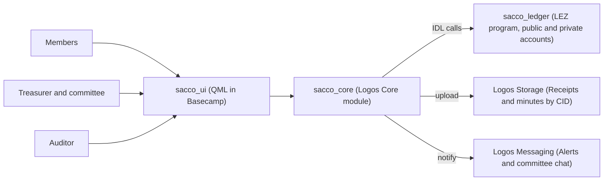

# Transparent SACCO on Logos — Pivot Roadmap

The start-to-finish map for Logos Circle Kampala's winnable issue: what we build, who owns which piece, the order we do it in, and how we know we won. **12 steps, 8 phases.**

## The project at a glance

| | |
|---|---|
| Problem | SACCO members cannot see how savings, loans and expenses are handled, so trust is low. |
| Solution | A Logos app where every deposit, loan and expense is recorded and approved on chain, with members' personal finances kept private. |
| Circle | Logos Circle Kampala |
| Repo | `https://github.com/LOGOS-UGANDA/-Transparent-SACCO-Funds-Management` |
| Plan | 12 steps |
| Status | Phase 0, scoping |
| Scope (v1) | Deposits, loans and expenses. Investments (Wazalendo-style investment arms) are out of scope for v1. |

> **What winning means:** A real SACCO using the tool, members checking it, and measured results reported publicly. Strong code alone does not win a Circles issue.

> **Settled in review:** oversight is split from approval — a **Supervisory Committee** role sits beside the Committee. And the program is a **record, not a custodian**: value stays in mobile money and bank accounts, and the chain attests to what happened. The existing vault-custody code stays dormant.

## Architecture

Real money still moves through mobile money or cash. The chain is the shared, tamper-evident record of it, with approvals enforced by the program. The program holds no value — it attests to funds held off chain.

## Phases and tasks

Ticks show work already done.

### Phase 0: Scope and validate — Steps 1

| Steps | Lead workstream | Logos pieces | Done when |
|---|---|---|---|
| 1 | Community and pilot | Circles method | One pilot SACCO has signed off on three flows and the metrics. |

- [x] Field research at SACCOs around Kampala *(field research report)*
- [x] Workstreams formed *(workstreams report)*
- [ ] Pick one pilot SACCO and get written agreement
- [ ] Lock scope to three flows: deposits, loans, expenses
- [ ] Agree 2–3 metrics and run a baseline trust survey
- [ ] Name an owner for each workstream

### Phase 1: Domain model and LEZ program — Steps 2–4

| Steps | Lead workstream | Logos pieces | Done when |
|---|---|---|---|
| 2–4 | Logos Blockchain integration | LEZ (Rust, RISC Zero) | `sacco_ledger` passes tests for every instruction. |

- [x] Vault, multi-sig release flow and approver checks exist (`sacco_ledger`)
- [x] Program IDL exported (`artifacts/`)
- [ ] Bump `lee_core` to v0.3, fix breakages and deploy a hello-world program
- [ ] Rename `sacco_ledger` to `sacco_ledger` and drop university fee concepts
- [ ] Add SACCO, Member, Committee and Supervisory Committee accounts (approvers separate from supervisors)
- [ ] Make approver thresholds and role composition configurable per SACCO
- [ ] Add `RecordDeposit` with treasurer record and member confirmation
- [ ] Add loans: `ApplyLoan`, `ApproveLoan`, `DisburseLoan`, `RecordRepayment`
- [ ] Adapt release flow into `ProposeExpense`, approve, `ExecuteExpense`
- [ ] Add `PostPeriodSummary` for period totals
- [ ] Unit tests per instruction plus CI running `RISC0_DEV_MODE=1 cargo test`

### Phase 2: Upgrade and deploy — Steps 4

| Steps | Lead workstream | Logos pieces | Done when |
|---|---|---|---|
| 4 | Logos Blockchain integration | Testnet v0.3, `logos-scaffold` | Program deployed on local sequencer and testnet with a working call. |

- [ ] Switch docs and scripts from `logoscore`/`lgpm` to `logosctl`
- [ ] Deploy to local sequencer with `logos-scaffold`
- [ ] Deploy to testnet and record the program ID in the repo

### Phase 3: Core and UI wiring — Steps 5–7

| Steps | Lead workstream | Logos pieces | Done when |
|---|---|---|---|
| 5–7 | Backend and Frontend | Logos Core module, QML UI, Basecamp | One full flow works end to end inside Basecamp. |

- [x] `sacco_core` and `sacco_ui` scaffolds exist *(placeholder JSON only)*
- [ ] Wire `sacco_core` to LEZ through the IDL
- [ ] Member view: my deposits, my loan, SACCO totals
- [ ] Treasurer and committee view: record, propose, approve
- [ ] Auditor view: full trail with evidence links
- [ ] Demo flow: deposit, member views it, expense passes multi-sig

### Phase 4: Privacy — Steps 7–8

| Steps | Lead workstream | Logos pieces | Done when |
|---|---|---|---|
| 7–8 | Logos Blockchain integration | LEZ private accounts | Individual balances are private; SACCO totals stay public. |

- [ ] Move member balances and loans to private accounts
- [ ] Give auditor a view path for private data
- [ ] Keep SACCO totals, loan-book totals and expenses public
- [ ] Write a one-page privacy explainer for members

### Phase 5: Storage and Messaging — Steps 8–9

| Steps | Lead workstream | Logos pieces | Done when |
|---|---|---|---|
| 8–9 | Backend | Logos Storage, Logos Messaging | Receipts stored by CID and members get alerts. |

- [ ] Upload receipts, loan agreements and minutes to Logos Storage
- [ ] Replace the free-text `evidenceHash` with the stored CID
- [ ] Member alerts: deposit recorded, loan approved, expense proposed
- [ ] Committee group chat for approvals

### Phase 6: Package and publish — Steps 9

| Steps | Lead workstream | Logos pieces | Done when |
|---|---|---|---|
| 9 | Frontend | `.lgx` packages, `logos-repo.json` | Anyone can install the app from Basecamp. |

- [ ] Build signed `.lgx` packages
- [ ] Fill `indexUrl` and fix the homepage in `logos-repo.json`
- [ ] Post the repo link on the Basecamp module forum thread

### Phase 7: Pilot and report — Steps 10–12

| Steps | Lead workstream | Logos pieces | Done when |
|---|---|---|---|
| 10–12 | Community and pilot | Circles reporting | Public report with metrics posted on the Logos forum. |

- [ ] Train treasurer and committee at the pilot SACCO
- [ ] Run the pilot with real members
- [ ] Repeat the trust survey and collect metrics
- [ ] Publish results on the Logos forum and X

## Step order

| Phase | Steps | Lead | Done when |
|---|---|---|---|
| 0 · Scope and validate | Steps 1 | Community and pilot | One pilot SACCO has signed off on three flows and the metrics. |
| 1 · Domain model and LEZ program | Steps 2–4 | Logos Blockchain integration | `sacco_ledger` passes tests for every instruction. |
| 2 · Upgrade and deploy | Steps 4 | Logos Blockchain integration | Program deployed on local sequencer and testnet with a working call. |
| 3 · Core and UI wiring | Steps 5–7 | Backend and Frontend | One full flow works end to end inside Basecamp. |
| 4 · Privacy | Steps 7–8 | Logos Blockchain integration | Individual balances are private; SACCO totals stay public. |
| 5 · Storage and Messaging | Steps 8–9 | Backend | Receipts stored by CID and members get alerts. |
| 6 · Package and publish | Steps 9 | Frontend | Anyone can install the app from Basecamp. |
| 7 · Pilot and report | Steps 10–12 | Community and pilot | Public report with metrics posted on the Logos forum. |

## Workstreams

| Workstream | Owns | Logos piece | First deliverable |
|---|---|---|---|
| UI/UX | Member, committee and auditor screens | Basecamp UX | Wireframes tested with pilot members |
| Frontend | `sacco_ui` and packaging | QML UI module, `.lgx` | Member view on real data |
| Backend | `sacco_core`, Storage, Messaging | Logos Core module | Core calls LEZ through the IDL |
| Logos Blockchain integration | `sacco_ledger`, deploys, privacy | LEZ | SACCO program with tests |
| Community and pilot | Partner SACCO, training, metrics | Circles method | Signed pilot agreement |

The earlier report names five workstreams; the fifth is shown here as Community and pilot — rename it to match what the Circle agreed.

## Data model

| Account or instruction | Kind | Visibility | Notes |
|---|---|---|---|
| SACCO | Account | Public | Name, registration, totals |
| Committee | Account | Public | Approvers; threshold configured per SACCO |
| Supervisory Committee | Account | Public | Oversight of approvers; elected separately |
| Member | Account | Private | Savings, shares, loan balance |
| RecordDeposit | Instruction | Member private, total public | Treasurer records, member confirms |
| ApplyLoan / ApproveLoan | Instruction | Private with public totals | Committee multi-sig |
| DisburseLoan / RecordRepayment | Instruction | Private with public totals | Evidence CID attached |
| ProposeExpense / ExecuteExpense | Instruction | Public | Records approval and release of funds held off chain |
| PostPeriodSummary | Instruction | Public | Period totals for all members |

## Metrics

| Metric | How we measure it | Phase |
|---|---|---|
| Members who check their record | Unique member logins during the pilot | Phase 7 |
| Share of activity on chain | Deposits, loans and expenses recorded, against the paper books | Phase 7 |
| Member trust | Same short survey before and after the pilot | Phases 0 and 7 |

## Winnability checklist

From the Logos Circles guide; about 80 percent ticked means the issue is winnable.

- [x] Real local problem confirmed by field research
- [ ] Narrow, clear scope with one pilot SACCO
- [ ] Validated with the people affected
- [ ] Built with the community through a small pilot
- [ ] Shareable result: working tool or public demo
- [ ] 2–3 simple metrics tracked
- [ ] Fits Logos values: transparency and privacy
- [ ] Finished in about three months and reported publicly

## Open questions

1. Which SACCO is the pilot partner, and who signs for it?
2. Does the v0.2.0 LEZ code compile against testnet v0.3?
3. Which is the main repo: upstream `makmot256`, the LOGOS-UGANDA fork, or `kaksv/Transparent-Sacco-on-logos`?
4. What came out of the recent SACCO Build Sprint at Makerere?
5. Should `RecordDeposit` distinguish share capital from savings? *(Phase 1 kickoff)*
6. What is the recovery path when a member exits or dies — how are private balances returned to beneficiaries? *(Phase 4 privacy)*
7. Which SACCO is realistically reachable for a pilot — institutional ones restrict membership, so is a community or trader SACCO more accessible?
8. What record-keeping and reporting obligations follow from SACCO registration with URSB?
9. How can public totals be checked against private balances, and what can an auditor or Supervisory Committee see? *(depends on what LEZ private accounts support)*

## How to start building

1. Install Basecamp, `logosctl` and Nix with flakes.
2. Use `logos-scaffold` to start a local sequencer and deploy `programs/sacco_ledger`.
3. `nix flake init -t github:logos-co/logos-module-builder/0.3.2`, then `nix build`.
4. `nix build .#lgx-portable`, then `logosctl package install`.

## References

- [Project repo](https://github.com/LOGOS-UGANDA/-Transparent-SACCO-Funds-Management) — github.com
- [Logos docs](https://docs.logos.co) — docs.logos.co
- [Write and deploy an LEZ program](https://docs.logos.co/lez/programs/write-and-deploy-lez-program-with-scaffold) — docs.logos.co
- [Build a Logos Core module](https://docs.logos.co/core/build-modules/build-and-run-a-logos-core-module) — docs.logos.co
- [What is a winnable issue](https://circles.logos.co/readme/for-circle-stewards/section-1-organising-circles-around-local-action/what-is-a-winnable-issue) — circles.logos.co
- [How Logos works](https://logos.co/field-guide/how-logos-works) — logos.co
- [Basecamp module repository thread](https://forum.logos.co/t/basecamp-module-repository-links/1843) — forum.logos.co
